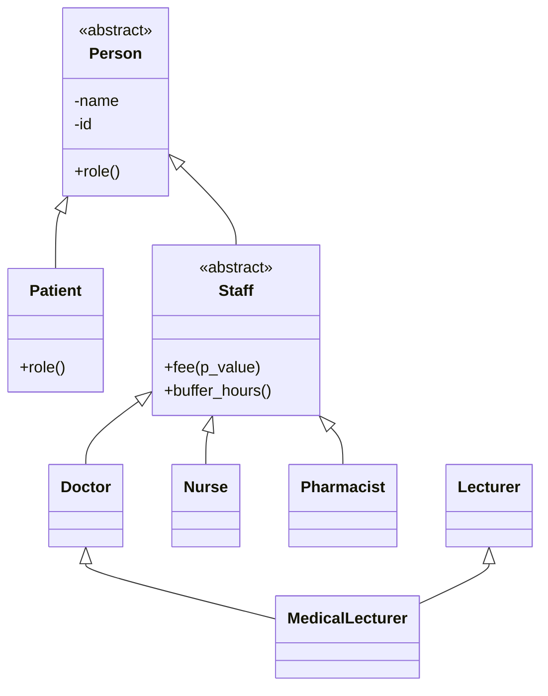

 
# Clinic Appointment System

## Project Overview
A clinic appointment management system implemented  in python designed to manage patient information and clinic appointments.
Our system aims to simplify the process of scheduling appointments in a clinic. It uses clear identification of patients and staff, allowing for booking cancellation with constraints,of appointments while also assigning fees, to allow the user to have a transparent flow. This project demonstrates object-oriented programming skills.

## Objectives
- Manage patient and staff information
- Unique identification of patients and staff members
- Validate appointment information
- Schedule clinic appointments and manage appointment status

## Technologies Used
- Python 3
- OOP (Object oriented Programming)

## Class Diagram

The following diagram illustrates the inheritance
structure of the system.

## Design Decision Log
# D1 
The 2 hour rule lives in the staff class implemented as buffer_hour()
# D2
The clock design is testable because we injected a clock dependancy into Clinic this allows for time simulation helpful to  control testing and improve consistency of test results.
# D3
- Since our design does not inherently depend on specific subclasses like Doctor or Nurse but on the Class Staff when we added Pharmacist it mainly changed the class design. 
# D4
- MedicalLecturer.fee() would return the doctor's fee since we did not override the method in our design MedicakLecturer class inherits from Doctor which hass the fee method. Pythons super() feature we used and MRO prevent  Person being created twice.
# D5
An explicit error should be shown to ensure that the issue is addressed within the system
# D6
0 the clinic should own the waiting list - since it is mainly responsible for appointment logging and patient registration
1 the appointment means that a commitment has been made between the doctor and patient so allowing a confirmed appointment to bumped makes our system lose its integrity
2 bufferhour is used to ensure system extensibility since it would mean our system just checks for the bufferhour without having to check for the specific subclass hence our scheduling algorithm will not need to change
3 Discount would live in the patient class since i is based on a specific patient - so we would need the id and name to reognize the patient

## Project Structure
clinic/
|
    |- appointment.py
    |- person.py
    |- clock.py
    |- clinic.py
    |- main.py
tests/
    |- __init__.py
    |- test1
    |- test2
    |- test3
    |- test4
    |- test5

- `person.py` - Defines Person, Patient,
  Staff, Doctor, Nurse, Pharmacist,
  Lecturer and MedicalLecturer.
- `clock.py` - Manages simulation time.
- `appointment.py` - Manages appointments
  and their status transitions.
- `clinic.py` - Manages clinic operations.
- `main.py` - Demonstrates the systm's functionality
- `tests/` - contains automated unit tests for the different components of the system

## Installation and SetUp
- download the project directory
- navigate to cd clinic
- run the file main.py in an IDE that supports python

# To run the test
- from the clinic directory execute ~ `python -m unittest discover -s tests -v`
The tests cover person creation and validation, clock functionality and time boundaries, appointment creation and status transition, clinic registratin and appointment scheduling, polymorphism and multiple inheritance

## Features
- System allows for appointment booking and cancellation
- Alows for patient registration- withh unique identification numbers
- Allows for staff registration and unique identifcation- staff members include pharmacist, doctors, nurses
- Allows for time blocking when scheduling appointments ensuring there is no booking overlap
- Calculates Consultation fees based on staff roles and patient information
- Records successful and unsuccesful operations in a log file
- Validates all inputs ensuring they are consistent- checking for non positive integers or empty strings
- Also makes use of error handling including ValueError, TypeError and RuntimeError
## Programming Principles Used

- Encapsulation
- Inheritance - Patient and Staffinherit functionalities from their parent classes
- Multiple Inheritance - Medical Lecturer inherits from both Doctor and Lecturer
- Polymorphism - Doctors, nurses and pharmacists implement their own fee() and buffer_hours() method
- Abstraction - created abstract classes such as person and staff
- Method overriding - in subclasses methods like role are redefined to suit that particular class

## Improvements
- Front end - graphical user interface of the system
- Connecting the system to an external database for data collection and other data related functions
- Rescheduling appointments
- Search functionality for particular patient
- Other features like a class of particular patient diagnosis, or database of symptoms faced with patients 